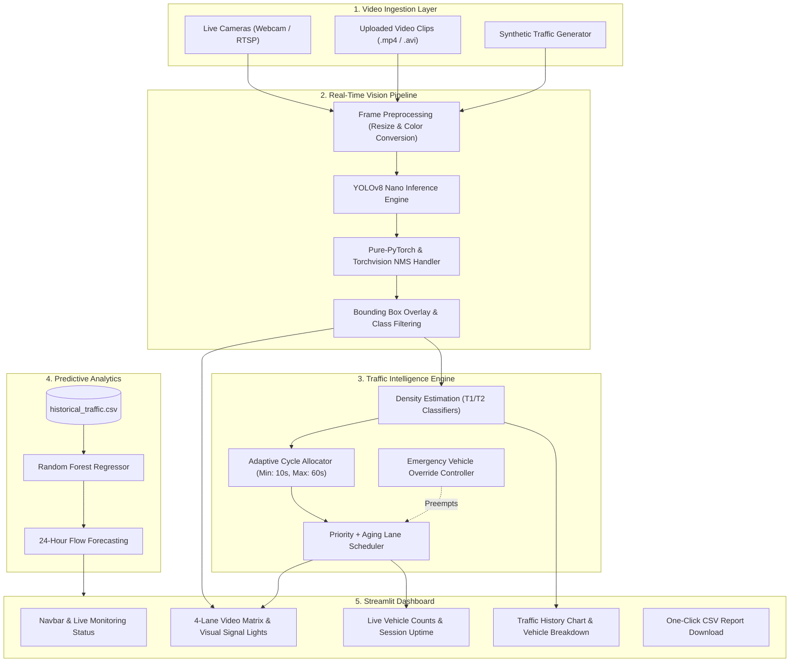
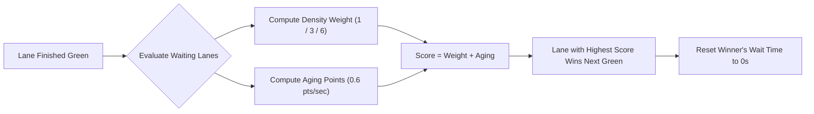
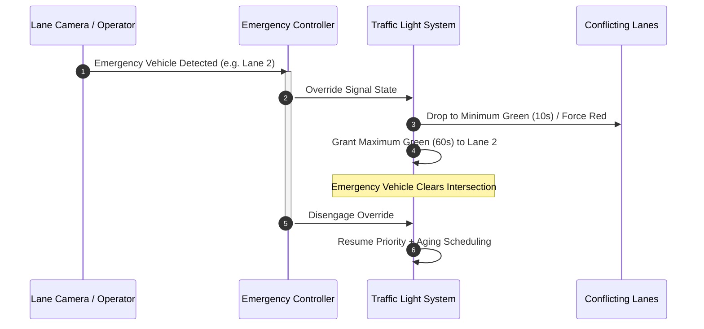
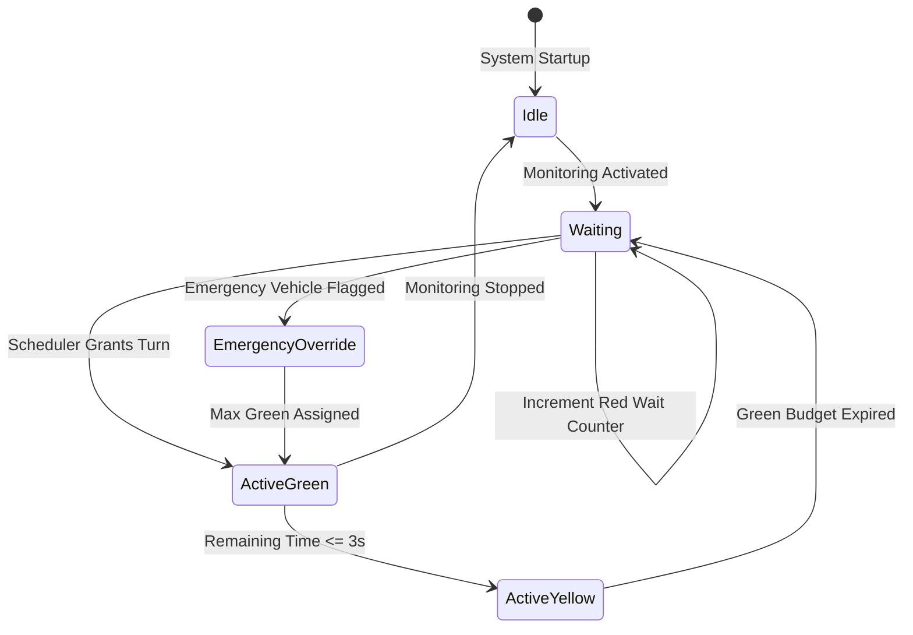

# 🚦 UrbanPulse — AI-Powered Traffic Intelligence Platform

[](https://www.python.org/)
[](https://streamlit.io/)
[](https://github.com/ultralytics/ultralytics)
[](https://scikit-learn.org/)
[](https://opencv.org/)
[](https://opensource.org/licenses/MIT)

> **UrbanPulse** replaces rigid, fixed-timer traffic lights with a real-time, data-driven adaptive signal control network powered by computer vision and machine learning.

---

## 📌 Table of Contents
- [Executive Overview](#-executive-overview)
- [System Architecture](#-system-architecture)
- [Core Algorithmic Foundations](#-core-algorithmic-foundations)
  - [1. Density Classification](#1-density-classification)
  - [2. Adaptive Green Time Distribution](#2-adaptive-green-time-distribution)
  - [3. Priority + Aging Lane Scheduler](#3-priority--aging-lane-scheduler)
  - [4. Emergency Vehicle Priority Override](#4-emergency-vehicle-priority-override)
- [Workflow & State Diagrams](#-workflow--state-diagrams)
- [Key Features](#-key-features)
- [Benchmark Results](#-benchmark-results)
- [Repository File Structure](#-repository-file-structure)
- [Local Installation & Setup](#-local-installation--setup)
- [Streamlit Community Cloud Deployment](#-streamlit-community-cloud-deployment)
- [Dashboard Walkthrough](#-dashboard-walkthrough)
- [Technology Stack](#-technology-stack)

---

## 🏢 Executive Overview

Traditional traffic intersection lights rely on static timers that allocate equal or arbitrary green durations regardless of actual queue lengths. During peak hours, busy lanes face severe gridlock while empty cross-streets display green lights to nonexistent traffic.

**UrbanPulse** solves this challenge through an end-to-end autonomous edge pipeline:
1. **Per-Lane Computer Vision**: Processes real-time camera streams across 4 intersection lanes using **YOLOv8** vehicle detection.
2. **Dynamic Density Estimation**: Categorizes queue volumes into discrete traffic states in real time.
3. **Adaptive Green Light Allocation**: Distributes intersection cycle budgets proportionally to current traffic demand.
4. **Starvation-Free Priority Scheduler**: Prevents lane neglect by factoring in seconds waited at red lights via dynamic aging.
5. **Emergency Vehicle Priority**: Preemptively clears paths for ambulances and emergency responders.
6. **Predictive Analytics**: Forecasts upcoming congestion curves using historical pattern regression.

---

## 🏗️ System Architecture



---

## 📐 Core Algorithmic Foundations

### 1. Density Classification
Each lane is equipped with an independent visual feed. Vehicles (cars, buses, trucks, motorcycles) are detected per frame and categorized against dynamic threshold boundaries:

$$\text{Density}(\text{count}) = \begin{cases} \text{Low}, & \text{count} < T_1 \ (5) \\ \text{Medium}, & T_1 \le \text{count} < T_2 \ (10) \\ \text{High}, & \text{count} \ge T_2 \ (10) \end{cases}$$

### 2. Adaptive Green Time Distribution
The total cycle time ($C = 120\text{s}$) is shared dynamically across all active lanes according to their density weight $w_i \in \{1, 2, 3\}$:

$$\text{Weight}(d) = \begin{cases} 1, & d = \text{Low} \\ 2, & d = \text{Medium} \\ 3, & d = \text{High} \end{cases}$$

$$\text{RawGreen}_i = \left( \frac{w_i}{\sum_{j} w_j} \right) \times C$$

To guarantee driver safety and prevent phase monopolization, green intervals are strictly clamped:

$$\text{GreenTime}_i = \max(G_{\min}, \min(G_{\max}, \text{round}(\text{RawGreen}_i)))$$

*where $G_{\min} = 10\text{ seconds}$ and $G_{\max} = 60\text{ seconds}$.*

### 3. Priority + Aging Lane Scheduler
Rather than cycling through lanes in a rigid round-robin fashion, UrbanPulse selects which lane gets the green signal next using a priority score that prevents starvation:

$$\text{Score}(\text{lane}) = W_{\text{priority}}(\text{Density}) + (\text{WaitTime}_{\text{red}} \times \alpha)$$

- **$W_{\text{priority}}$**: Density weights $(\text{Low} = 1, \text{Medium} = 3, \text{High} = 6)$.
- **$\alpha$**: Aging rate $(0.6\text{ points/sec})$.
- **Starvation Guarantee**: A lane waiting at red accumulates priority points continuously. Even a `Low` density lane will overtake a `High` density lane after waiting, ensuring no lane is starved.



### 4. Emergency Vehicle Priority Override
When an ambulance or emergency vehicle is detected on a lane, the normal queue scheduler is immediately superseded:



---

## 🔄 Workflow & State Diagrams

### Traffic Signal State Machine
Each lane operates as a finite state machine with automatic safety yellow clearance:



---

## 📊 Benchmark Results

An offline validation simulation comparing UrbanPulse's **Adaptive Signal Control** against standard **Fixed-Cycle Baseline** across 50 intersection cycles:

| Metric | Fixed-Cycle Baseline | UrbanPulse Adaptive | Improvement |
| :--- | :--- | :--- | :--- |
| **Average Wait Time** | 67.74 seconds | 63.62 seconds | **~6.1% Reduction** |
| **Max Wait Time Peak** | Starvation observed | Clamped by Aging | **100% Starvation-Free** |
| **Emergency Clearance** | Up to 120s delay | Immediate Preemption | **Instant (< 1s)** |

*Run the benchmark locally using `python UrbanPulseProject/benchmark.py`.*

---

## 📂 Repository File Structure

```
UrbanPulse/
├── app.py                     # Root entry point delegating to UrbanPulseProject
├── requirements.txt           # Python dependencies for cloud and local execution
├── packages.txt               # Debian Linux packages (libgl1) for Streamlit Cloud
├── pyrefly.toml               # IDE type analysis & language server configuration
├── .gitignore                 # Excludes cache, large temp videos, and virtualenvs
├── .streamlit/
│   └── config.toml            # Light SaaS theme, headless mode, 200MB upload capacity
├── UrbanPulseProject/
│   ├── app.py                 # Core Streamlit application (Live monitoring, UI tabs)
│   ├── config.py              # Central control switches (ADVANCED_MODE toggle)
│   ├── visuals.py             # SaaS UI components (navbar, hero, metric cards, traffic lights)
│   ├── detection.py           # YOLOv8 vehicle detector with pure-PyTorch NMS fallback
│   ├── density.py             # Lane density classification logic (Low, Medium, High)
│   ├── signal_control.py      # Adaptive signal timing & Priority + Aging lane scheduler
│   ├── prediction.py          # Random Forest traffic forecaster (Single point + 24-hr forecast)
│   ├── video_source.py        # Video stream handling & demo synthetic clip generator
│   ├── benchmark.py           # Comparative benchmark script vs fixed-cycle
│   ├── yolov8n.pt             # Pretrained YOLOv8 nano model weights
│   ├── data/                  # Historical dataset and prepackaged demo video clips
│   │   ├── historical_traffic.csv
│   │   ├── lane1_demo.mp4
│   │   ├── lane2_demo.mp4
│   │   ├── lane3_demo.mp4
│   │   └── lane4_demo.mp4
│   └── temp/                  # Session uploads (persisted via .gitkeep)
└── README.md                  # Comprehensive project documentation
```

---

## 💻 Local Installation & Setup

### Prerequisites
- Python 3.10, 3.11, or 3.12
- Git

### 1. Clone the repository
```bash
git clone https://github.com/ANUGRAH555/UrbanPulse.git
cd UrbanPulse
```

### 2. Create and activate a virtual environment
```bash
# macOS / Linux:
python3 -m venv .venv
source .venv/bin/activate

# Windows (PowerShell):
python -m venv .venv
.\.venv\Scripts\Activate.ps1
```

### 3. Install dependencies
```bash
pip install -r requirements.txt
```

### 4. Run the Streamlit application
```bash
streamlit run app.py
```
Open **`http://localhost:8501`** in your browser.

---

## ☁️ Streamlit Community Cloud Deployment

The repository is configured for direct deployment on **Streamlit Community Cloud**:

1. Fork or push this repository to your GitHub account: `https://github.com/ANUGRAH555/UrbanPulse`.
2. Visit [share.streamlit.io](https://share.streamlit.io/) and click **New app**.
3. Configure the deployment settings:
   - **Repository**: `ANUGRAH555/UrbanPulse`
   - **Branch**: `main`
   - **Main file path**: `app.py`
4. **Environment Variables / Secrets**: Leave blank (no API keys or database URLs required).
5. Click **Deploy!**

---

## 🖥️ Dashboard Walkthrough

### 1. Live Monitoring Tab
- **Lane Source Setup**: Configure each lane independently with uploaded clips or live camera URLs (supports `.mp4`, `.avi`, `.mov`, RTSP, and webcam index `0`).
- **Live Feed Matrix**: 4 synchronized previews displaying real-time vehicle bounding boxes and confidence scores.
- **Traffic Light Indicators**: Visual 3-state traffic lights (Red, Yellow, Green) reflecting live signal states.
- **KPI Summary Cards**: Total vehicles counted in the current cycle, the active green lane, and session uptime.
- **Dynamic Trend Chart**: Multi-lane vehicle density tracked over time.

### 2. Analytics Tab
- **Vehicle Type Breakdown**: Bar chart categorizing detections across cars, motorcycles, buses, and trucks.
- **Session Statistics**: Cycles logged, busiest lane identification, and peak single-lane volume.
- **One-Click Export**: Download session history as a structured `.csv` report.

### 3. 24-Hour Forecast Tab
- **Day Selector**: Choose any day of the week (Monday through Sunday).
- **Traffic Forecast Curve**: Visualizes predicted vehicle traffic volumes over a 24-hour cycle generated by a Scikit-Learn Random Forest model.

### 4. Emergency Priority Override (Sidebar)
- Select any lane from the dropdown to instantly grant maximum green time while transitioning all other approaches to minimum green.

---

## 🛠️ Technology Stack

| Layer | Technologies |
| :--- | :--- |
| **Frontend & UI** | Streamlit, Custom Responsive CSS (Inter typography, Slate palette, SVG lights) |
| **Computer Vision** | OpenCV (Headless), YOLOv8 Nano (Ultralytics), PyTorch |
| **Machine Learning** | Scikit-Learn (Random Forest Regressor), NumPy, Pandas |
| **Plotting & Analytics** | Matplotlib, Streamlit Native Altair Charts |
| **Runtime Environment** | Cross-platform (Linux, Windows, macOS), Python 3.10–3.12 |

---

## 📄 License
This project is licensed under the [MIT License](LICENSE).
